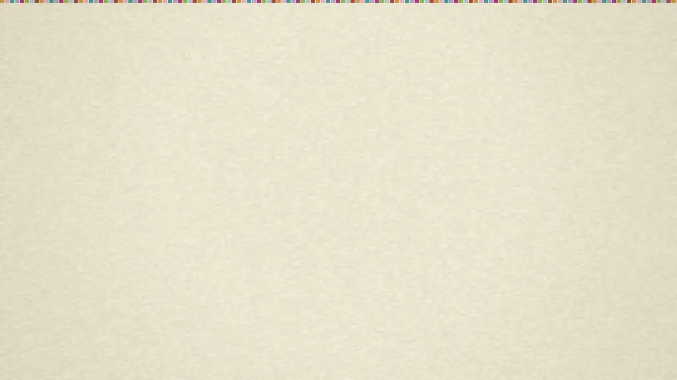

# ASCII QR Studio

Turn any image and URL into a scannable QR code made of ASCII art.

**Image → ASCII art → ASCII QR pattern → static QR image**, all on your own machine. Every result is re-read by an independent QR decoder before you get it.

<p align="center"></p>

## Features

- **Tone-preserving ASCII.** Each character cell gets its own glyph color and background color, so shading survives the conversion. No photo is layered behind the QR.
- **Verified output.** A result is kept only if it decodes to the exact URL under 14 conditions (color and black-and-white × original, grayscale, two downscales, blur, rotation and JPEG).
- **Local web studio.** Upload, crop, tune the character density, compare original / ASCII / color QR / black-and-white QR, then download the view you like as a PNG or everything as a ZIP.
- **Command line.** The same pipeline as scriptable commands.
- **Private by default.** Runs in Docker, binds to localhost only, and never uploads your files or visits the URL you encode.

## Quick start

You need Docker Engine with Docker Compose. Nothing else is installed on your host.

```bash
git clone https://github.com/finddme/ascii-qr-studio.git
cd ascii-qr-studio
./studio.sh
```

Open **http://localhost:8787**.

1. Choose an image. Optionally drag on it to pick the area to use.
2. Enter the URL the QR should open.
3. Adjust the character density (fewer columns look bold and simple, more look detailed).
4. Press **READY?** and wait for the decode checks.
5. Switch between the views and press **Download … (PNG)** to save the one you are looking at, or **All files (ZIP)** for everything. Past jobs stay in **History**, where you can reopen, regenerate or delete them.

Limits: images up to 12 MB and 24 megapixels; one conversion runs at a time.

```bash
docker compose stop web       # stop the studio
git pull && ./studio.sh       # update to the latest version
```

## Command line

```bash
./qr.sh /path/to/image.png --url https://example.com/
./qr.sh /path/to/image.png --url https://example.com/ \
  --columns 64 --fit cover --min-version 6 --output dev/output/my-design
./convert.sh /path/to/image.png --preset bold --renderer tonal   # ASCII only
```

Results are written under `dev/output/`, and existing folders are never overwritten. `--crop LEFT TOP RIGHT BOTTOM` takes values from 0 to 1 and is applied before `--fit`. Cropping is manual; there is no automatic background removal.

| Option | Meaning |
| --- | --- |
| `--columns 64` | Characters per row. Fewer is bolder and simpler, more is finer. |
| `--fit contain` / `cover` | Keep the whole image / fill a centered square. |
| `--renderer tonal` / `classic` | Preserve per-cell tone / classic glyphs on a flat background. |
| `--core-style adaptive` / `solid` | Adjust module centers only as much as needed / pure black-and-white dots. |
| `--min-version 6` | Minimum QR version. Long URLs raise it automatically. |
| `--module-pixels 24` | Output pixels per QR module (not a print size). |

Exit codes: `0` success, `2` invalid input, `3` no candidate passed every decode check.

## Output

| File | Contents |
| --- | --- |
| `selected-color.png`, `selected-mono.png` | The chosen design, in color and black and white. Created only when every check passes. |
| `preview.html` | Original framing, ASCII and QR side by side, plus every strength candidate. |
| `validation.json` | The decoded value of every check, settings and decoder version. |
| `ascii/` | ASCII as TXT, per-cell style JSON and PNG. |

`tonal` rendering uses real glyph masks and exactly two colors per cell. Plain TXT cannot store those colors, so use the PNG or the cell JSON to reproduce the look.

## How verification works

Finder, timing and other function patterns are kept intact, along with a 4-module quiet zone. The studio tries data-module core widths of 30, 40, 50, 60 and 80%. It tests each candidate under 7 conditions in both color and black and white, and picks the passing candidate that hides the least of your image.

A decoder pass is not a judgment of how good the image looks, and it is not a guarantee that a camera will read it. Check that your image is still recognizable. Test a print or screen at its real size with real phones. The best settings depend on the image and the URL, and longer URLs make denser codes.

## Your data

Everything you create stays in `dev/`. That folder is ignored by Git and excluded from Docker builds.

| Path | Contents |
| --- | --- |
| `dev/input/` | Input files you manage yourself |
| `dev/output/` | Command-line results |
| `dev/jobs/<id>/` | Studio jobs: input PNG, settings, hashes, results and validation |
| `dev/qa/` | Browser test captures |

A downloaded ZIP leaves out the separate `input.png`, but it still contains previews of your image and the URL. Review it before sharing. History is never synced anywhere and never expires on its own.

## Development

```bash
./test.sh   # run the unit and API test suite inside Docker
```

`./test.sh`, `./qr.sh` and `./convert.sh` rebuild the Docker image automatically when the code has changed, so you never need to run `docker compose build` yourself. All tests use synthetic images and never contact the network.

## Releases

- Pull requests and pushes to `main` build the Docker image, run all tests and check that no personal files are tracked.
- Pushing a `v*` tag checks it against `VERSION`, runs the same tests and publishes `ghcr.io/finddme/ascii-qr-studio:<version>` (plus a commit-SHA tag). Use a version tag for reproducible runs.

```bash
# after updating VERSION, testing and committing
git tag v0.1.1
git push origin main v0.1.1
```

## More

Algorithms, dependencies and references are in [docs/TECHNOLOGY.md](docs/TECHNOLOGY.md).
